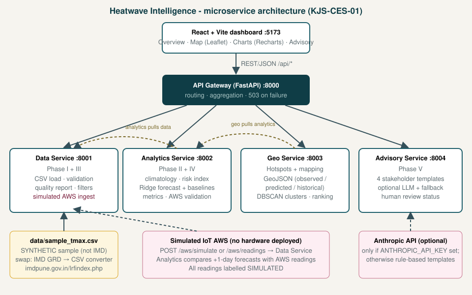

# AI-Based Heatwave Hotspot Intelligence & Climate Risk Mapping

Mini-project for **AI Use Case KJS-CES-01 — Climate Intelligence for Heatwave Monitoring, Prediction and Early Warning**
(Collaborating organisation named in the use case: IMD Mumbai-Pune). Assessment component: *AI Use Case Microservice Demonstration* (15 marks).

> **Read this first — what is real and what is not**
> * The official IMD dataset could not be downloaded while building this project. The app ships with a **synthetic sample CSV** (`data/sample_tmax.csv`, source label `SAMPLE_SYNTHETIC`): real city coordinates, **simulated** temperatures. Every screen says so.
> * Real IMD data can be dropped in with the same schema; `scripts/imd_grd_to_csv.py` converts GRD files (grid layout must be verified — see `docs/DATASET.md`).
> * There is **no AWS hardware**. AWS readings are produced by a *simulated* endpoint and labelled so (Phase III is demonstrated as software plumbing only).
> * The risk categories are a **prototype risk index** with IMD-style thresholds recalled from memory and *not verified online*. It is not an IMD heatwave declaration; advisories are drafts labelled "NOT an official IMD warning".
> * Model skill: the Ridge forecast beats persistence and climatology on average Tmax error, but **detects very few High+ heat events** (shown in the Validation tab). Numbers describe synthetic data only.

## What it does
A React dashboard backed by five FastAPI services: analyse historical Tmax, forecast the next 5 days, classify heatwave risk, map hotspots (observed / predicted / historical — kept visually separate), generate stakeholder advisories (citizen, health, farmer, authority), validate forecasts against (simulated) AWS readings, and show service health.



| Service | Port | Responsibility |
|---|---|---|
| Data Service | 8001 | Load + validate CSV, quality report, filters, simulated AWS ingest |
| Analytics Service | 8002 | Climatology, risk index, Ridge forecast + baselines, metrics, hotspot scores, AWS validation |
| Geo Service | 8003 | GeoJSON, DBSCAN clusters, rankings (observed / predicted / historical) |
| Advisory Service | 8004 | Stakeholder advisories (rules; optional LLM with fallback), human-review status |
| API Gateway | 8000 | Single entry point `/api/*`, aggregation, graceful 503s |
| Frontend | 5173 | Overview, Map, Temperature, Hotspots, Advisory, Validation, System |

Details: `docs/ARCHITECTURE.md`, `docs/API.md`, `docs/DATASET.md`, `docs/METHODOLOGY.md`, `docs/TESTING.md`, `docs/DEMO_SCRIPT.md`.

## How the five phases of the use case are covered
| Phase (official document) | Implemented here | Status |
|---|---|---|
| I. Meteorological data acquisition | Data Service: CSV ingestion, timestamp/lat-lon/range/duplicate/sentinel checks, missing-value report, region + season segmentation; converter for IMD GRD | Working (sample data; real IMD data needs manual download) |
| II. AI-driven analytics & prediction | Analytics Service: climatology/anomalies, regional & seasonal stats, 1–5 day Tmax forecast (Ridge on anomalies) vs baselines, severity classification, historical + predicted hotspots | Working |
| III. IoT-enabled weather monitoring | Data Service `/aws/*` endpoints and a simulator (`POST /aws/simulate`) | **Simulated only** |
| IV. Forecast validation & intelligence | MAE/RMSE/POD/FAR on a time-based hold-out; forecast vs AWS comparison in `/validation/aws` | Working (AWS data simulated) |
| V. Advisory, early warning, decision support | Dashboard + Advisory Service; LLM wording optional; draft/human-review workflow; disclaimers | Working; not an operational alert system |

Governance items from the use case's table (uncertainty communication, human-in-the-loop, factual consistency for LLM text, validation) appear as: 90 % intervals, review status buttons, an LLM prompt restricted to supplied facts with rule-based fallback, and the Validation tab.

## Quick start (local, verified path)
Requirements: Python 3.10+ and Node 18+.
```bash
# 1. backend deps (one environment for all services)
pip install -r services/data_service/requirements.txt -r services/analytics_service/requirements.txt \
            -r services/geo_service/requirements.txt -r services/advisory_service/requirements.txt \
            -r services/gateway/requirements.txt

# 2. (optional) regenerate the synthetic sample data - a copy is already in data/
python scripts/generate_sample_data.py

# 3. start all five services
python scripts/run_all.py            # wait ~15 s: the analytics model trains at start-up

# 4. frontend (new terminal)
cd frontend && npm install && npm run dev      # http://localhost:5173
```
Swagger/OpenAPI docs: http://localhost:8000/docs (gateway) and `/docs` on ports 8001–8004. Map background tiles come from OpenStreetMap, so the browser needs internet access.

**Optional LLM wording:** `export ANTHROPIC_API_KEY=...` (Windows: `set`) before step 3, then tick "LLM-assisted wording" in the Advisory tab. Model name via `ADVISORY_LLM_MODEL` (default `claude-sonnet-5-5`). Without a key, or on any API error, rule-based text is used. This path was not exercised with a real key during development.

**Docker (not tested in the authoring sandbox):** `docker compose up --build`, then open http://localhost:8080.

**Tests:** `pytest -q tests` (unit tests, no services needed) and `python tests/smoke_check.py` (30 end-to-end checks against the running stack).

## Configuration (environment variables)
| Variable | Default | Used by |
|---|---|---|
| `DATA_CSV` | `data/sample_tmax.csv` | data service |
| `DATA_SERVICE_URL`, `ANALYTICS_SERVICE_URL`, `GEO_SERVICE_URL`, `ADVISORY_SERVICE_URL` | `http://localhost:800x` | analytics, geo, gateway |
| `TRAIN_END` | last date − 365 days | analytics (time-based split) |
| `RISK_CONFIG` | `services/analytics_service/risk_config.json` | analytics (thresholds, hotspot weights) |
| `CLUSTER_EPS_KM`, `HISTORICAL_HOTSPOT_MIN_SCORE` | 450, 40 | geo |
| `ANTHROPIC_API_KEY`, `ADVISORY_LLM_MODEL` | empty / `claude-sonnet-5-5` | advisory |
| `AWS_SIM_STATIONS` | `DEL,NGP,MAA,JAI,CCU,HYD` | data (simulator) |
| `CORS_ORIGINS` | localhost:5173 (gateway) | all |
| `VITE_API_BASE` | empty (dev proxy to :8000) | frontend |

## Using real IMD data
1. Download daily maximum-temperature GRD files from https://imdpune.gov.in/lrfindex.php (manual step).
2. Check the grid specification on that page, then `python scripts/imd_grd_to_csv.py --inputs <files> --years <years> --out data/imd_tmax.csv` (override `--nlat/--nlon/--lat0/--lon0/--res/--missing` if needed).
3. `DATA_CSV=data/imd_tmax.csv python scripts/run_all.py`. Grid cells become stations; region is assigned by approximate lat/lon boxes unless you supply a `region` column with the faculty's seven-region list; terrain defaults to "plains". Review `risk_config.json` thresholds first.

## Known assumptions & limitations
* The **seven regions** are my grouping (Western Himalaya & Hills, Northwest Plains, Central India, West Coast & Gujarat, East India, Northeast India, South Peninsula) because the use-case text does not list them. Replace with the IMD list you are given.
* Season split used: Winter Jan–Feb, Pre-monsoon Mar–May, Monsoon Jun–Sep, Post-monsoon Oct–Dec.
* Synthetic data have only 5 years, 28 points and an artificial climate; trends and skill numbers are illustrative.
* Hotspot "historical" scores use the same prototype risk index; "predicted" hotspots are model output with uncertainty; "observed" is the record. Hindcast as-of dates before the train/test boundary are in-sample and flagged as optimistic.
* Station-scale points only: no interpolation, no claims about local conditions between points; no humidity/wet-bulb heat-index (Tmax only).
* Prediction intervals assume roughly normal, constant-width errors; the model shrinks towards normal and under-predicts extremes.
* The AWS store and advisory store are in memory (reset on restart). No authentication.
* Future work: real IMD grids and 0.25° data, humidity/heat index, gradient-boosting or ConvLSTM models, persistent DB, authenticated reviewer roles, real AWS ingestion over MQTT, SMS/CAP alert dissemination after official approval.
