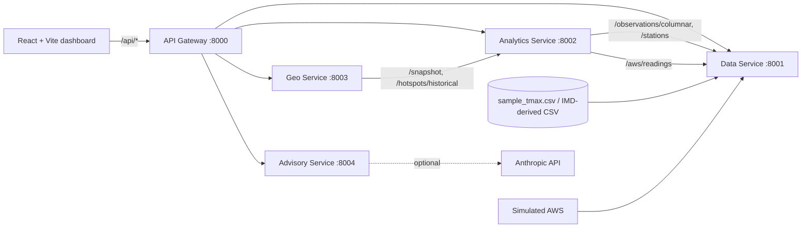

# Architecture

## Why each service exists
| Service | Why it is separate |
|---|---|
| Data | Owns the dataset and its quality rules; the only component that reads files or accepts sensor input, so real IMD/AWS feeds change nothing else |
| Analytics | Holds model + risk logic independent of UI and maps; can be retrained or swapped (e.g. gradient boosting) without touching others |
| Geo | Spatial concerns (GeoJSON, clustering, ranking) with a different dependency set and different change cadence |
| Advisory | Generative / communication layer with an external dependency (LLM) that must fail safely without affecting forecasts |
| Gateway | One URL and CORS policy for the UI; aggregates calls (overview, advisory) and turns upstream failures into clear 503s |

## Data flow
1. Data Service loads and validates the CSV at start-up (`/quality` reports every fix).
2. Analytics Service fetches the clean columnar export, builds climatology from the **training years only**, computes anomalies and risk levels, trains one Ridge model per lead time, evaluates on the later hold-out year.
3. A UI request (e.g. Map → Forecast) hits the gateway → Geo → Analytics `/snapshot` → GeoJSON back to Leaflet.
4. Advisory: gateway fetches the forecast from Analytics, builds a fact payload, Advisory Service renders text and stores a DRAFT awaiting human review.
5. Simulated AWS readings go to the Data Service; Analytics compares them with the +1-day forecast issued the previous day.

## Failure behaviour
Verified by stopping the Geo service: gateway returns `503 {"detail":"The 'geo' service is unavailable ..."}` for map/overview calls, `/api/health` shows `degraded`, and forecast/advisory endpoints keep working. The frontend shows an error box for the affected panel only. Analytics retries data-service connection for ~2 minutes at start-up.

## Deliberate simplifications
Synchronous REST/JSON only, in-memory stores, no auth, no message broker or database: appropriate for a demo and easy to explain.
